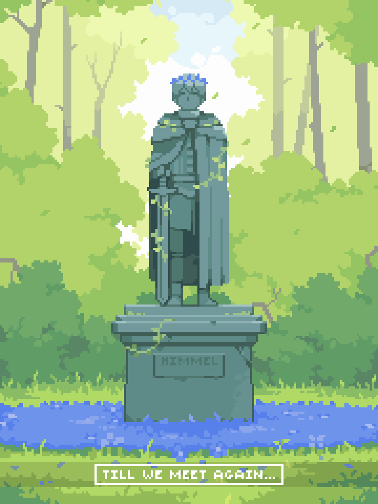

<table>
<td width="50%" valign="top">

## About me

I am a systems and embedded software developer working in C, C++ and Rust on Linux.
I finished the common core at 42 Lyon and I am looking for a 6-month internship in systems, embedded or low-level software, starting January 2027 (Lyon or Paris).

What I like working on:

- Systems programming and Linux internals
- Embedded Linux and real-time video
- Performance-oriented design
- Backend development
- Assembly && CPU architecture

I enjoy understanding how things work under the hood, from memory management in C to building complete tools from scratch.

Contact: <david.derny@ik.me>

</td>
<td width="50%" valign="top">

[ArkhaiPxls](https://x.com/ArkhaiPxls)
</td>
</table>

## Projects

### Systems and embedded

- [Handover-Car (FPV RC car over 5G)](https://github.com/Equoo/Handover-Car) - A radio-controlled car driven through a live video feed over a 5G network, built with [42Timeo](https://github.com/42Timeo) and [Amidigov](https://github.com/amidigov).
- [Valgrind Breaker](https://github.com/Equoo/valgrind_breaker) - Malloc failure injection on top of Valgrind. Fails each allocation in turn to find leaks and crashes on error paths. Tool for 42 students.
- [STD Games](https://github.com/Equoo/STDGames) - A Linux game launcher for 42 students: no setup and no login required. Runs each game from distant directory, sandboxed with bubblewrap, Linux namespaces and overlayfs. V2 in progress.

### Web

- [KeepGrouped (ft_transcendence)](https://github.com/Equoo/transcendance) - A real-time web platform, final project of the 42 common core, built by a team of 4. I was tech lead (stack choice, pull request reviews) and wrote the whole Discord-like messaging system: data model, backend, real-time layer and frontend. C# / ASP.NET Core, SignalR, PostgreSQL, React / TypeScript.

### 42 Cursus

- [Minishell](https://github.com/Equoo/42-minishell) - A Unix shell in C with pipes, redirections and expansions, built as a pair.
- [Philosophers](https://github.com/Equoo/42-philosophers) - The Dining Philosophers problem in C with POSIX threads: race conditions, mutexes and deadlock prevention.
- [Cub3D](https://github.com/Equoo/42-cub3d) - A raycasting 3D maze engine in C, inspired by Wolfenstein 3D, built as a pair.
- [ft_irc](https://github.com/Pulse-rar/ft_irc) - An IRC server in C++98, team project.
- [CPP Modules](https://github.com/Equoo/42-cppmodules) - The 42 C++98 modules.
- [Libft](https://github.com/Equoo/42-libft) - My reimplementation of part of the C standard library, used as a base for my other C projects at 42.
- [So_Long](https://github.com/Equoo/42-so_long) - A small 2D game in C on top of a basic pixel drawing library.

